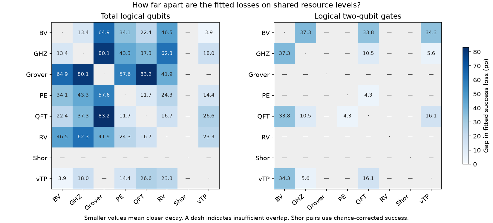

# Which algorithms have similar decay?

Compared all 28 pairs of observed algorithms. Each resource metric and outcome has its own grouping. Family labels enter only after clustering.

In each campaign/window, fit each algorithm’s line on at least three identical observed resource levels. The absolute difference in fitted changes from the first shared level to the last is the absolute slope difference multiplied by that resource span. Multiply by 100 to express the gap in target points (percentage points for success). This measures slope agreement independently of the starting success rate. Different pairs can have different spans, and short spans can hide slope differences.

Use the median gap over at least 2 eligible periods. Start with one group per supported algorithm and merge the groups whose largest cross-group gap is smallest. Stop when no merge keeps every pair within 5 points. A missing distance prevents a merge. Ties resolve alphabetically. Pairwise support can come from different periods or levels within a group.

The exploratory tolerance of 5 points is a display choice. Memberships are also exported at 2.5 and 10 points. The provisional grouping admits pairs observed in only one period (minimum_periods=1 in memberships.csv). Repeated periods reuse configurations. The groups describe these data and have no inferential equivalence interpretation.

Read each gap with its interval. pair_comparisons.csv gives a 95% bootstrap interval for the median gap (gap_ci_low, gap_ci_high) and the bootstrap probability that the median gap is within 5 points (p_within_tolerance). A gap whose interval straddles the tolerance is neither a match nor a mismatch. Pairs involving Shor are read on chance-corrected success (primary_outcome), because Shor's raw success falls with its chance floor.

Bootstrap: 1000 draws; jobs are resampled with replacement within each configuration at each resource level (algorithm × level × configuration × period), so the set of configurations and levels stays fixed; deviations of a resampled configuration mean are scaled by sqrt(n/(n-1)) to offset the small number of repetitions, and a configuration with one job contributes no variation. This is not binomial shot resampling: it reflects job-to-job variation, which includes shot noise. Intervals are 2.5th to 97.5th percentiles.

## Pairs whose interval reaches the 5-point tolerance

Primary outcome only. Family labels are annotations; unrelated pairs appear here too.

| Resource | Pair | Role | Outcome | Periods | Median gap [95% interval] | P(gap ≤ 5) |
| --- | --- | --- | --- | ---: | ---: | ---: |
| a.depth | vTP / GHZ | entanglement | success | 3 | 1.09 [0.37, 3.08] | 1.00 |
| a.size | GHZ / QFT | other | success | 3 | 3.13 [0.60, 7.30] | 0.84 |
| b.depth | BV / GHZ | other | success | 3 | 3.14 [0.89, 5.71] | 0.91 |
| a.num_qubits | BV / vTP | other | success | 3 | 3.87 [2.62, 5.72] | 0.87 |
| b.depth | vTP / GHZ | entanglement | success | 3 | 4.27 [1.62, 7.04] | 0.70 |
| a.ComplexityMetrics.gate_based_metrics.two_qubit_count | QFT / PE | fourier | success | 3 | 4.34 [1.66, 7.89] | 0.58 |
| a.quantum_specific.entanglement_ratio | QFT / PE | fourier | success | 3 | 4.39 [3.10, 6.21] | 0.74 |
| b.two_qubit_depth | BV / GHZ | other | success | 3 | 4.57 [2.92, 7.24] | 0.58 |
| b.depth | BV / PE | other | success | 2 | 4.99 [2.33, 7.86] | 0.48 |
| a.size | GHZ / RV | control | success | 3 | 5.17 [2.53, 7.83] | 0.38 |
| a.depth | GHZ / QFT | other | success | 3 | 5.45 [4.58, 6.29] | 0.18 |
| a.ComplexityMetrics.gate_based_metrics.two_qubit_count | vTP / GHZ | entanglement | success | 3 | 5.58 [3.71, 7.36] | 0.23 |
| b.two_qubit_gates | BV / GHZ | other | success | 3 | 6.48 [4.78, 8.22] | 0.06 |
| b.two_qubit_depth | QFT / PE | fourier | success | 3 | 6.49 [3.53, 9.86] | 0.18 |
| a.size | vTP / GHZ | entanglement | success | 3 | 7.39 [4.70, 9.13] | 0.05 |

| Resource | Outcome | Supported pairs | Groups with ≥2 members | Singletons | Insufficient overlap |
| --- | --- | ---: | --- | --- | --- |
| a.BehavioralMetrics.program_communication | chance_corrected | 0 | — | — | BV, GHZ, Grover, PE, QFT, RV, Shor, vTP |
| a.BehavioralMetrics.program_communication | dsr | 0 | — | — | BV, GHZ, Grover, PE, QFT, RV, Shor, vTP |
| a.BehavioralMetrics.program_communication | hellinger_fidelity | 0 | — | — | BV, GHZ, Grover, PE, QFT, RV, Shor, vTP |
| a.BehavioralMetrics.program_communication | normalized | 0 | — | — | BV, GHZ, Grover, PE, QFT, RV, Shor, vTP |
| a.BehavioralMetrics.program_communication | success | 0 | — | — | BV, GHZ, Grover, PE, QFT, RV, Shor, vTP |
| a.BehavioralMetrics.program_communication | tvd_similarity | 0 | — | — | BV, GHZ, Grover, PE, QFT, RV, Shor, vTP |
| a.ComplexityMetrics.gate_based_metrics.two_qubit_count | chance_corrected | 7 | PE + QFT | BV, GHZ, vTP | Grover, RV, Shor |
| a.ComplexityMetrics.gate_based_metrics.two_qubit_count | dsr | 7 | — | BV, GHZ, PE, QFT, vTP | Grover, RV, Shor |
| a.ComplexityMetrics.gate_based_metrics.two_qubit_count | hellinger_fidelity | 7 | GHZ + QFT | BV, PE, vTP | Grover, RV, Shor |
| a.ComplexityMetrics.gate_based_metrics.two_qubit_count | normalized | 7 | PE + QFT | BV, GHZ, vTP | Grover, RV, Shor |
| a.ComplexityMetrics.gate_based_metrics.two_qubit_count | success | 7 | PE + QFT | BV, GHZ, vTP | Grover, RV, Shor |
| a.ComplexityMetrics.gate_based_metrics.two_qubit_count | tvd_similarity | 7 | GHZ + QFT | BV, PE, vTP | Grover, RV, Shor |
| a.StructuralMetrics.volume | chance_corrected | 1 | — | PE, QFT | BV, GHZ, Grover, RV, Shor, vTP |
| a.StructuralMetrics.volume | dsr | 1 | — | PE, QFT | BV, GHZ, Grover, RV, Shor, vTP |
| a.StructuralMetrics.volume | hellinger_fidelity | 1 | — | PE, QFT | BV, GHZ, Grover, RV, Shor, vTP |
| a.StructuralMetrics.volume | normalized | 1 | — | PE, QFT | BV, GHZ, Grover, RV, Shor, vTP |
| a.StructuralMetrics.volume | success | 1 | — | PE, QFT | BV, GHZ, Grover, RV, Shor, vTP |
| a.StructuralMetrics.volume | tvd_similarity | 1 | — | PE, QFT | BV, GHZ, Grover, RV, Shor, vTP |
| a.depth | chance_corrected | 11 | GHZ + vTP | BV, Grover, PE, QFT, RV | Shor |
| a.depth | dsr | 11 | — | BV, GHZ, Grover, PE, QFT, RV, vTP | Shor |
| a.depth | hellinger_fidelity | 11 | GHZ + vTP | BV, Grover, PE, QFT, RV | Shor |
| a.depth | normalized | 11 | GHZ + vTP | BV, Grover, PE, QFT, RV | Shor |
| a.depth | success | 11 | GHZ + vTP | BV, Grover, PE, QFT, RV | Shor |
| a.depth | tvd_similarity | 11 | GHZ + vTP | BV, Grover, PE, QFT, RV | Shor |
| a.num_qubits | chance_corrected | 20 | PE + QFT | BV, GHZ, Grover, RV, vTP | Shor |
| a.num_qubits | dsr | 20 | BV + GHZ | Grover, PE, QFT, RV, vTP | Shor |
| a.num_qubits | hellinger_fidelity | 20 | BV + vTP · PE + QFT | GHZ, Grover, RV | Shor |
| a.num_qubits | normalized | 20 | — | BV, GHZ, Grover, PE, QFT, RV, vTP | Shor |
| a.num_qubits | success | 20 | BV + vTP | GHZ, Grover, PE, QFT, RV | Shor |
| a.num_qubits | tvd_similarity | 20 | BV + vTP · PE + QFT | GHZ, Grover, RV | Shor |
| a.quantum_specific.entanglement_ratio | chance_corrected | 2 | — | Grover, PE, QFT, vTP | BV, GHZ, RV, Shor |
| a.quantum_specific.entanglement_ratio | dsr | 2 | — | Grover, PE, QFT, vTP | BV, GHZ, RV, Shor |
| a.quantum_specific.entanglement_ratio | hellinger_fidelity | 2 | — | Grover, PE, QFT, vTP | BV, GHZ, RV, Shor |
| a.quantum_specific.entanglement_ratio | normalized | 2 | — | Grover, PE, QFT, vTP | BV, GHZ, RV, Shor |
| a.quantum_specific.entanglement_ratio | success | 2 | PE + QFT | Grover, vTP | BV, GHZ, RV, Shor |
| a.quantum_specific.entanglement_ratio | tvd_similarity | 2 | — | Grover, PE, QFT, vTP | BV, GHZ, RV, Shor |
| a.size | chance_corrected | 14 | GHZ + QFT | BV, Grover, PE, RV, vTP | Shor |
| a.size | dsr | 14 | GHZ + RV | BV, Grover, PE, QFT, vTP | Shor |
| a.size | hellinger_fidelity | 14 | GHZ + QFT | BV, Grover, PE, RV, vTP | Shor |
| a.size | normalized | 14 | GHZ + QFT | BV, Grover, PE, RV, vTP | Shor |
| a.size | success | 14 | GHZ + QFT | BV, Grover, PE, RV, vTP | Shor |
| a.size | tvd_similarity | 14 | GHZ + QFT | BV, Grover, PE, RV, vTP | Shor |
| b.depth | chance_corrected | 5 | BV + GHZ | PE, vTP | Grover, QFT, RV, Shor |
| b.depth | dsr | 5 | BV + GHZ | PE, vTP | Grover, QFT, RV, Shor |
| b.depth | hellinger_fidelity | 5 | BV + GHZ | PE, vTP | Grover, QFT, RV, Shor |
| b.depth | normalized | 5 | BV + GHZ | PE, vTP | Grover, QFT, RV, Shor |
| b.depth | success | 5 | BV + GHZ | PE, vTP | Grover, QFT, RV, Shor |
| b.depth | tvd_similarity | 5 | BV + GHZ | PE, vTP | Grover, QFT, RV, Shor |
| b.two_qubit_depth | chance_corrected | 8 | BV + GHZ · PE + QFT | RV, vTP | Grover, Shor |
| b.two_qubit_depth | dsr | 8 | BV + GHZ | PE, QFT, RV, vTP | Grover, Shor |
| b.two_qubit_depth | hellinger_fidelity | 8 | — | BV, GHZ, PE, QFT, RV, vTP | Grover, Shor |
| b.two_qubit_depth | normalized | 8 | BV + GHZ · PE + QFT | RV, vTP | Grover, Shor |
| b.two_qubit_depth | success | 8 | BV + GHZ | PE, QFT, RV, vTP | Grover, Shor |
| b.two_qubit_depth | tvd_similarity | 8 | BV + GHZ | PE, QFT, RV, vTP | Grover, Shor |
| b.two_qubit_gates | chance_corrected | 6 | — | BV, GHZ, PE, QFT, RV, vTP | Grover, Shor |
| b.two_qubit_gates | dsr | 6 | GHZ + vTP | BV, PE, QFT, RV | Grover, Shor |
| b.two_qubit_gates | hellinger_fidelity | 6 | PE + QFT | BV, GHZ, RV, vTP | Grover, Shor |
| b.two_qubit_gates | normalized | 5 | — | BV, GHZ, PE, RV, vTP | Grover, QFT, Shor |
| b.two_qubit_gates | success | 6 | — | BV, GHZ, PE, QFT, RV, vTP | Grover, Shor |
| b.two_qubit_gates | tvd_similarity | 6 | PE + QFT | BV, GHZ, RV, vTP | Grover, Shor |

[Pairwise gaps and support](pair_comparisons.csv) · [Membership at each tolerance](memberships.csv) · [Pair recurrence across resources, with family annotations](pair_recurrence.csv) · [Dashboard data](decay_groups.json). The per-period slopes, exact levels, and observed profiles are in the parent directory’s decay_comparisons.csv and matched_levels.csv.
