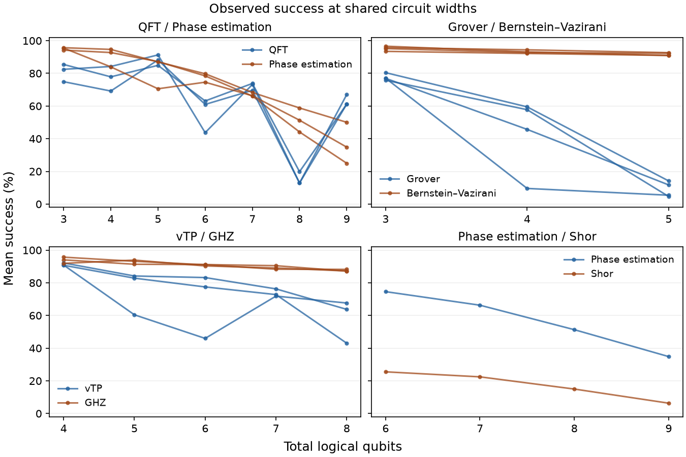

# Do related circuits lose success in the same way?

Backend ibm_fez. The cohort contains 1,236 jobs and 189 configurations in 9 collection periods.

[Linear fits, target definitions, and comparison table](trend_review.md)

[All algorithm pairs and exploratory decay groups](groups/report.md)

Each comparison uses exact resource values observed for both algorithms in the same campaign and window. At each resource value we average repetitions within each configuration, then give each configuration equal weight. At least three shared values are required. Each value has equal weight in the descriptive straight-line slope.

Spearman rho measures whether the observed success means rank the shared resource values similarly. The slopes show the direction and average size of change per unit. Step-rate Spearman rho ranks the observed changes per resource unit between adjacent levels and compares those ranks when at least three intervals exist. The adjacent-interval counts show how often both workloads actually decline or rise over the same step. A high rho can accompany very different slopes. Correlating two fitted nonconstant straight lines on the same grid would always give +1 or −1.

Error is one minus success, so the raw error slopes have the opposite signs and the same magnitudes. Normalized comparisons use (success − chance) / (ideal success − chance) wherever the denominator exceeds 1e-8.

## Width comparisons

Ranges below span eligible collection periods and describe variation across periods. Repeated configurations recur across periods. Width is total logical qubits and may represent different computational resources across workloads.

Each line connects observed means within one collection period.

| Pair | Periods | Shared widths per period | Spearman ρ | Success change A (pp/qubit) | Success change B (pp/qubit) |
| --- | ---: | ---: | ---: | ---: | ---: |
| BERNSTEIN-VAZIRANI / GHZ | 3 | 13 | 0.60 to 0.98 | -3.24 to -2.75 | -2.25 to -2.01 |
| GROVER / BERNSTEIN-VAZIRANI | 4 | 3 | 1.00 | -35.83 to -32.62 | -2.83 to -1.25 |
| BERNSTEIN-VAZIRANI / PHASE-ESTIMATION | 3 | 7 | 0.93 to 1.00 | -7.38 to -2.43 | -11.64 to -8.12 |
| BERNSTEIN-VAZIRANI / QFT | 3 | 7 | 0.61 to 0.93 | -7.38 to -2.43 | -7.40 to -6.16 |
| BERNSTEIN-VAZIRANI / RANDOM-VOLUMETRIC | 3 | 6 | 0.94 | -8.17 to -1.96 | -14.51 to -11.75 |
| BERNSTEIN-VAZIRANI / VTP | 3 | 5 | 0.20 to 1.00 | -9.58 to -2.15 | -10.55 to -3.50 |
| GHZ / GROVER | 3 | 4 | 0.80 to 1.00 | -2.32 to -1.63 | -34.06 to -26.79 |
| GHZ / PHASE-ESTIMATION | 3 | 7 | 0.89 to 1.00 | -2.62 to -1.77 | -11.64 to -8.12 |
| GHZ / QFT | 3 | 8 | 0.74 to 0.95 | -2.40 to -1.83 | -7.54 to -6.83 |
| GHZ / RANDOM-VOLUMETRIC | 3 | 7 | 0.89 to 0.96 | -1.92 to -1.68 | -14.24 to -12.15 |
| VTP / GHZ | 3 | 5 | 0.20 to 1.00 | -10.55 to -3.50 | -1.98 to -1.41 |
| GROVER / PHASE-ESTIMATION | 3 | 3 | 1.00 | -35.83 to -33.14 | -12.46 to -3.52 |
| GROVER / QFT | 3 | 4 | 0.20 to 0.80 | -34.06 to -26.79 | -3.90 to -1.30 |
| GROVER / RANDOM-VOLUMETRIC | 3 | 4 | 1.00 | -34.06 to -26.79 | -15.95 to -13.67 |
| QFT / PHASE-ESTIMATION | 3 | 7 | 0.61 to 0.79 | -7.40 to -6.16 | -11.64 to -8.12 |
| PHASE-ESTIMATION / RANDOM-VOLUMETRIC | 3 | 6 | 0.94 to 1.00 | -9.69 to -7.71 | -14.51 to -11.75 |
| PHASE-ESTIMATION / VTP | 3 | 5 | 0.20 to 1.00 | -11.83 to -6.96 | -10.55 to -3.50 |
| QFT / RANDOM-VOLUMETRIC | 3 | 7 | 0.61 to 0.82 | -11.04 to -9.45 | -14.24 to -12.15 |
| QFT / VTP | 3 | 5 | 0.20 to 0.80 | -16.08 to -12.72 | -10.55 to -3.50 |
| VTP / RANDOM-VOLUMETRIC | 3 | 5 | 0.10 to 0.90 | -10.55 to -3.50 | -13.89 to -11.65 |
| BERNSTEIN-VAZIRANI / SHOR | 1 | 5 | 0.30 | -3.04 | -5.68 |
| GHZ / SHOR | 1 | 5 | 1.00 | -2.62 | -5.68 |
| PHASE-ESTIMATION / SHOR | 1 | 4 | 1.00 | -13.42 | -6.50 |
| QFT / SHOR | 1 | 4 | 0.60 | -5.98 | -6.50 |
| SHOR / RANDOM-VOLUMETRIC | 1 | 3 | 1.00 | -5.27 | -21.00 |
| SHOR / VTP | 1 | 3 | 1.00 | -5.27 | -17.22 |

## QFT and phase estimation by logical two-qubit gate count

| Period | Shared levels | Profile ρ | QFT loss (pp/gate) | PE loss (pp/gate) | Correlation of local rates |
| --- | ---: | ---: | ---: | ---: | ---: |
| fez-dataset-v2 / window 1 | 5 | 0.70 | 1.00 | 1.81 | -0.60 |
| fez-dataset-v2-2026-11-05 / window 20261105 | 5 | 0.90 | 1.12 | 1.18 | 0.00 |
| fez-full-shor-growth-v1-2026-11-06 / window 20261106 | 5 | 0.60 | 1.10 | 1.21 | 0.80 |

## Interpretation

These are descriptive comparisons. With three shared sizes, even perfect rank agreement uses only three points. Changing configuration mix across widths, different success criteria, and shared hardware noise can affect trends. Random-volumetric profiles provide a generic comparator. Interpreting differences between pairs requires checking the common levels used by each pair. [Matched controls](matched_controls.csv) compare both family members with the mirror circuit at the same levels in the same period.

The comparison does not assign a predictive R² threshold or infer slope equivalence. The existing family interaction models provide configuration-clustered uncertainty for slope differences across their fitted ranges, which can extend beyond the exact shared levels used here.

See [all metric comparisons](decay_comparisons.csv), [observed level means](matched_levels.csv), and [coverage including unsupported comparisons](overlap.csv).
